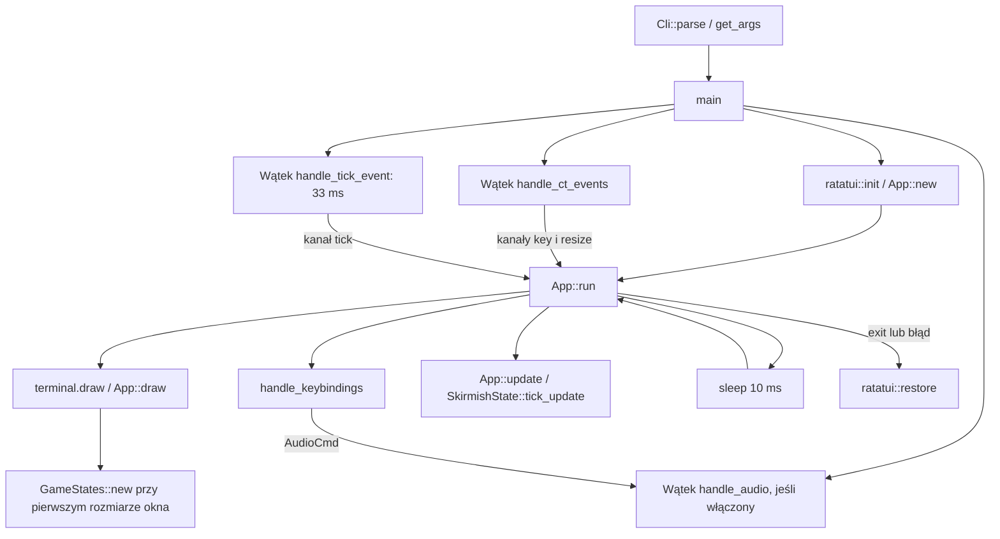
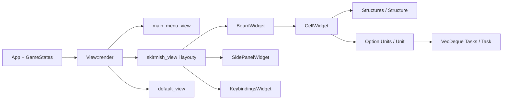

# Mapa kodu i przepływu

Migawka: 2026-10-19. Projekt `war_in_tunnels` 0.1.0 to prototyp terminalowego RTS. Działają menu, plansza, nawigacja, zlecanie i wykonywanie kopania, magazyny Wood/Metal, dostawy drewna, budowanie Mine, obsadzanie kopalni górnikiem, rekrutacja Miner w Base i audio. Walka i pełna ekonomia pozostają poza zakresem obecnej symulacji.

## Moduły i odpowiedzialność

Wszystkie ścieżki poniżej są względem katalogu głównego repozytorium.

| Obszar | Pliki | Odpowiedzialność |
|---|---|---|
| Start | `src/main.rs`, `src/lib.rs` | CLI, kanały, wątki, terminal, eksporty biblioteki |
| Parametry | `src/cli.rs`, `src/logs.rs` | Clap, walidacja zakresów, opcjonalny logger |
| Pętla aplikacji | `src/app/app.rs` | `App`, inicjalizacja stanów przy pierwszym rysowaniu, wejście, resize, update |
| Zbiór stanów | `src/app/state.rs`, `src/app/states/` | `GameStates`, menu, potyczka, ustawienia, perki, umiejętności |
| Routing widoku | `src/app/view.rs`, `src/app/views/` | `View`, implementacja `Widget for &mut App`, layouty i ekrany |
| Wejście | `src/app/keybind.rs`, `src/app/keybindings/` | Routing według widoku, `KEYBINDINGS`, `Action`, `Group`, mapowanie zdarzeń |
| Plansza | `src/app/states/skirmish_states/board.rs` | Tworzenie mapy, kamera, zoom, focus, zaznaczenia, zlecanie i wykonywanie zadań |
| Współrzędne | `focused_cell.rs`, `offset.rs`, `marked_cells.rs`, `zoom_level.rs` w `skirmish_states/` | Granice kursora i przewijania, ścieżka zaznaczenia, rozmiar komórek |
| Obiekty gry | `skirmish_states/structures/`, `units/`, `tasks/` | Traity `Structure`, `Unit`, `Task` i delegujące enumy `Structures`, `Units`, `Tasks` |
| Zasoby | `skirmish_states/resources.rs`, `states/skirmish.rs`, `structures/mine.rs` | Osobne magazyny gracza i przeciwnika, pasywne Wood i wydobycie metalu z ograniczonego złoża |
| Rekrutacja | `structures/base.rs`, `units/miner.rs`, `states/skirmish.rs`, `board.rs` | Koszt górnika, niezależne kolejki baz i bezpieczne pojawianie się jednostek po ruchu |
| Widgety | `src/app/widgets/` | Plansza, komórka, panel boczny i legenda klawiszy |
| Pomocniczy layout | `src/app/helpers/` | Obszar komórek, tytuły bloków i tekst opcji menu |
| Wątki | `src/app/threads/{events,tick,audio}.rs` | Crossterm, zegar 33 ms, Rodio i komendy audio |
| Środowisko | `Cargo.toml`, `flake.nix`, `default.nix`, `flake.lock` | Zależności, toolchain Fenix, ALSA, pakowanie przez Naersk lub buildRustPackage |
| Formatowanie | `rustfmt.toml` | Rustfmt, styl 2024, wcięcia po 2 spacje, docelowo 100 znaków i zakończenia LF |
| Kontrole CI | `.gitea/workflows/tests.yml` | Workflow `Project tests` po pushu i dla pull requestów; kolejność przez `needs`: `check → nix → linux → aur`. Job `check` w `node:22-bookworm`: Rust 1.99.1 przez rustup, cache toolchaina i Cargo, formatowanie, kompilacja, testy debug/release i Clippy |
| Budowa paczki Nix | `.gitea/workflows/tests.yml` (job `nix`) | Po sukcesie `check` buduje `.#default`, czyli `default.nix` przez nixpkgs przypięte w `flake.lock`, z testami i kontrolą instalacji pakietu |
| Paczki Linux | `.gitea/workflows/tests.yml` (joby `linux`, `aur`), `packaging/` | Po sukcesie `nix`: testowe deb, rpm, AppImage i Flatpak w `linux`, następnie makepkg dla AUR w `aur`; bez wydań i tagów; szczegóły w `docs/PACKAGING.md` |
| Licencja | `LICENSE`, `Cargo.toml`, `default.nix` | MIT, Copyright (c) 2026 GarandPLG |
| Zasoby | `soundtracks/default/`, `ui_draft/` | Dwa pliki OGG i tekstowe szkice ekranów |

Ścieżki skrócone `skirmish_states/` oznaczają `src/app/states/skirmish_states/`. Nie ma osobnego silnika gry, bazy danych ani warstwy sieciowej. Zależności Cargo: Ratatui/Crossterm, Clap, Rodio, log/simplelog i once_cell.

`Cargo.toml` deklaruje Rust 1.88 jako minimalną wspieraną wersję, wymusza `unused_must_use = "deny"` i `unsafe_code = "forbid"` we własnym kodzie, dopuszcza `clippy::unused_unit` oraz włącza `overflow-checks` w release. Toolchain deweloperski nadal pochodzi z Fenix przypiętego przez `flake.lock`; wersję 1.88.0 sprawdzono osobno.

## Uruchomienie i pętla

Kanały to standardowe `std::sync::mpsc`. Stan gry mutuje główny wątek. Każdy obrót pętli najpierw rysuje, następnie próbuje odebrać po jednym zdarzeniu z każdego kanału. Aktualizacja potyczki odbywa się niezależnie od wybranego ekranu. `tick_update` wykonuje kroki jednostek przez advance_turn_with_events, rozlicza podpory i zawalenia, rekrutację, budowę oraz zasoby, a następnie zwiększa licznik czasu.

`GameStates::new` tworzy wszystkie stany jednocześnie. `SettingsState` przechowuje parametry z CLI; `SkirmishState` ma odrębne bieżące `player_resources` i `enemy_resources`, inicjalizowane z starting_wood/starting_metal. Nagłówek TUI odczytuje te magazyny zamiast ustawień. `--starting-iron` jest aliasem nowego `--starting-metal`; XP, supply i tryb gry nadal nie mają pełnej symulacji. `View` zawiera MainMenu, Skirmish, PerkDecks i SkillsConfig. Dwa ostatnie używają `default_view` z napisem „Work in progress”; ustawienia nie mają osobnego wariantu `View`.

## Renderowanie i dane

`BoardState.cells: Vec<Vec<CellWidget>>` łączy model i prezentację: komórka zawiera strukturę, opcjonalną jednostkę, pozycję i flagi UI. `BoardWidget` wybiera widoczne komórki przez offsety i layout; `CellWidget` odpowiada za ich tekst i styl. Panel boczny prezentuje dane zaznaczenia. Zoom wpływa na wielkość komórek i liczbę widocznych wierszy/kolumn; resize i przełączanie panelu zmieniają granice offsetów.

Mapa powstaje deterministycznie: kamień, baza gracza w `(map_height / 2, 2)`, baza przeciwnika w `(map_height / 2, map_width - 3)`, sąsiadujące neutralne złoża i po jednym górniku w bazie. Kopalnie nie są rozmieszczane na starcie. CLI domyślnie wybiera mapę 42 × 11; dopuszczalne zakresy to szerokość 36–108 i wysokość 11–39. Struktury to Base, Ore, Stone, Tunnel, MineConstruction, Mine i CollapsedTunnel; jedyna jednostka to Miner. Zadania to Digging i Moving, implementujące wspólny trait Task.

`Resources` przechowuje Wood i Metal jako u32; dodawanie saturuje zamiast przepełniać licznik. `tick_update` po zadaniach jednostek dodaje graczowi 5 Wood co 152 ticki (5016 ms). Co 31 ticków (1023 ms) kopalnie wydobywają po 1 Metal lub 2 Metal, jeśli na ich kratce stoi własny Miner. `Mine::accepts_unit` określa możliwość obsadzenia, a `production_per_cycle` ogranicza wydobycie pozostałą zawartością złoża. Rzeczywiście uzyskana ilość jest odejmowana z Ore i dopisywana właścicielowi. Wyczerpane złoże pozostaje z ilością zero. SidePanelWidget pokazuje tempo i aktywny bonus Miner. Wartości i okresy określają stałe w resources.rs oraz Mine::METAL_PER_CYCLE/STAFFED_METAL_PER_CYCLE.

`BoardState::can_build_at` sprawdza granice, pustą kratkę, własnego sąsiedniego budowniczego (cztery kierunki) i BuildingTerrain. Zwykłe budynki wymagają kamienia połączonego krawędzią z tunelem lub własną bazą; Mine wymaga neutralnego, niewyczerpanego Ore i omija wyłącznie warunek połączenia, nigdy obecność budowniczego. `Unit::get_can_build` ma domyślnie false, Miner zwraca true, a Units i Option delegują uprawnienie. Gameplay wywołuje SkirmishState::start_mine_construction: sprawdza zasoby, ponownie waliduje teren i pobiera Mine::COST (20 Wood, 10 Metal). Niedobór dowolnego zasobu nie zmienia planszy ani magazynu. BoardState odpowiada za warstwę terenu, nie opłaty. Nie ma jeszcze innych budowanych obiektów.

MineConstruction zachowuje gotowy model Mine z oryginalnym Ore oraz licznik budowy. Po ruchu jednostek BoardState::advance_construction nalicza tick tylko przy sąsiednim własnym budowniczym; odejście pauzuje budowę, powrót wznawia. Po 304 tickach (10032 ms, około 10 sekund) struktura staje się Mine. Do tego czasu nie można do niej wejść ani wydobywać. Procenty są na kratce, w panelu Tab i widoku budowania. SkirmishState::cancel_mine_construction dopuszcza tylko własny aktywny plac, przywraca oryginalne neutralne Ore i jednokrotnie zwraca koszt; zakończonej kopalni nie da się w ten sposób sprzedać. Resources::spend sprawdza oba zasoby przed odjęciem.

`available_skirmish_actions` jest wspólne dla obsługi wejścia i legendy. Na mapie spacja jest dostępna przy własnym górniku, a zoom zależy od poziomu. Rysowanie trasy ukrywa zoom, przewijanie i budowanie; Esc anuluje trasę. b otwiera SkirmishState::building_view dla wskazanego pola. Poprawne pole z funduszami udostępnia Enter/Build Mine; panel pozostaje otwarty z procentami i Delete/Cancel construction dla własnej trwającej budowy. b tylko zamyka panel, nie anuluje budowy. Muzyka i wyjście są globalne. Widget legendy stosuje opisy zależne od kontekstu i szerokości kolumn proporcjonalne do tekstu, zachowując stałą wysokość stopki i geometrię mapy.

`Structures::can_enter` jest wspólną regułą dla planowania trasy i jej wykonywania: baza i tunel pozostają przechodnie; Mine przyjmuje własnego Minera, jeżeli kratka nie jest zajęta. Wejście do kopalni jest Moving (około 3 sekund), również gdy zadanie wcześniej miało typ Digging. Obsadzony górnik pozostaje jedyną jednostką na kratce, można go zaznaczyć i wyprowadzić zwykłą trasą. Bonus wylicza się z bieżącej obecności jednostki po ruchu; nie ma osobnej kopii pracownika ani osobnego zadania pracy.

BaseBuilding przechowuje queued_miners, recruitment_ticks i waiting_for_departure. Ponieważ kolejka obsługuje wyłącznie identycznych Minerów, wystarcza licznik pozycji zamiast listy obiektów. SkirmishState::recruit_miner sprawdza typ i właściciela bazy, granice, pojemność licznika i MinerUnit::RECRUIT_COST (10 Wood, 15 Metal), po czym opłaca dodanie pozycji. BoardState::advance_recruitment jest wywoływane po ruchu jednostek, przed budowaniem i wydobyciem. Pierwszy Miner rekrutuje się przez 304 ticki (10032 ms), nawet na zajętej bazie; przy 100% czeka na wolne pole. Spawn tworzy jednostkę z właścicielem i współrzędnymi bazy oraz pustą kolejką zadań. Po spawnie waiting_for_departure blokuje odliczanie kolejnych pozycji, dopóki baza jest zajęta. Nigdy nie nadpisujemy obecnej jednostki. Każda baza ma osobną kolejkę; przeciwnik korzysta z własnych zasobów.

r jest dostępne na własnej Base poza rysowaniem trasy i widokiem budowania. SkirmishState::recruitment_view otwiera modal z kosztem, liczbą pozycji, procentem i statusem Recruiting/Ready/Paused. Enter dodaje Minera tylko przy wystarczających zasobach. r zamyka panel, zachowując kolejkę; ruch mapy i otwarcie innego modalu są wtedy zablokowane. Opisy w legendzie zależą od trybu, a postęp i liczba pozycji są też pod Tab.

## Klawisze i zlecanie kopania

Okna budowania i rekrutacji mają Tabs oraz osobne indeksy selected_building/selected_recruit w SkirmishState. Listy BUILDING_OPTIONS/RECRUITMENT_OPTIONS zawierają obecnie Mine i Support / Miner. cycle_popup_option zawija wybór strzałkami Left/Right w obrębie aktywnego okna, bez ruchu planszy. Przy dodawaniu kolejnego typu trzeba uzupełnić listę oraz powiązać szczegóły, walidację i akcje Enter/Delete z jego indeksem; obecna implementacja akcji obsługuje tylko istniejące typy.

CellWidget pokazuje cyjanowy postęp BaseBuilding::recruitment_progress na środku kratki, gdy queued_miners > 0. Wskaźnik obejmuje 0% i oczekiwanie przy 100%; po opróżnieniu kolejki znika. W najmniejszym zoomie 100 nie ma sufiksu %, aby zmieścić trzy znaki. Rekrutacja ma pierwszeństwo przed procentem ruchu jednostki opuszczającej bazę; w zwykłym i dużym zoomie zachowany jest znacznik jednostki.

1. `handle_ct_events` odbiera zdarzenie Crossterm i przekazuje je kanałem do `App`.
2. `handle_keybindings` wybiera obsługę menu, potyczki albo domyślną.
3. `event_to_action` porównuje kod, rodzaj i modyfikatory z `KEYBINDINGS`, następnie obsługuje znak wildcard.
4. Akcje wspólne realizują wyjście, powrót do menu i komendy audio.
5. W potyczce ruch zmienia focus i ewentualnie kamerę; zoom przelicza rozmiary; Tab przełącza panel.
6. Spacja przełącza zaznaczanie. `start_marking_cells` zapamiętuje jednostkę z komórki początkowej; ruch dopisuje współrzędne do kolejki. Backspace cofa ścieżkę, Delete ją anuluje.
7. `end_marking_cells(false)` pomija pierwsze pole i dzieli trasę na kolejne jednorodne odcinki: `MovingTask` dla tuneli/baz i `DiggingTask` dla kamienia. Dodaje je do kolejki w kolejności ścieżki; w panelu zadania mają ikony `→` i `⛏`.

`start_marking_cells` dopuszcza wyłącznie własnego górnika. Jeśli ma już zadania, nowa ścieżka zaczyna się na końcu ostatniego zadania. Jednostka wybrana do rysowania wstrzymuje wykonywanie zadań do zatwierdzenia lub anulowania trasy; powtarzany ruch przy granicy nie dopisuje kolejnych kopii tej samej kratki.

`advance_turn` najpierw zbiera pozycje pracujących jednostek, aby każda była aktualizowana tylko raz. Wyjmuje jednostkę i pierwsze zadanie, sprawdza granice, sąsiedztwo i zajętość celu. Przy kamieniu różnica skumulowanego postępu zadania daje obrażenia: `digging_power` 0.55 oznacza około 5.5 durability na tick przy maksymalnym durability 1000. Zaokrąglenie skumulowanej wartości zachowuje część ułamkową. Pełne kopanie trwa około 182 ticków (6 sekund). `Stone::take_damage` nie pozwala zejść poniżej zera.

Po zniszczeniu kamienia cel staje się tunelem i jednostka wchodzi do niego w tym samym ticku w ramach `Digging`. `MovingTask` obsługuje przejście do istniejącego tunelu lub pustej bazy: wymaga 91 ticków (3003 ms przy `TICK_MS = 33`), nie zmienia durability. Jego licznik `ticks` resetuje się dla każdego kroku; blokada lub rysowanie trasy wstrzymuje naliczanie. Jeśli teren zmieni się od zaplanowania trasy (np. kamień został już wykopany albo ścieżka wraca przez nowy tunel), `advance_turn` zmienia typ bieżącego zadania według aktualnego celu, zachowując pozostałą ścieżkę i kolejkę.

Ruch aktualizuje współrzędne jednostki i usuwa krok ścieżki. Zakończone zadanie znika, następne może wykonać się od kolejnego ticka. Zajęty cel lub ruda blokuje pracę bez niszczenia obiektu. Pusta ścieżka jest usuwana, a cel poza mapą lub niesąsiadujący anuluje bieżące zadanie bez teleportacji. Uszkodzony kamień pokazuje pozostałą wytrzymałość w procentach na planszy; panel boczny pokazuje dokładne durability. Znacznik jednostki jest osobnym stylowanym `Span` z kolorem `Players::get_color()`, niezależnym od koloru tunelu i zaznaczenia komórki.

Postęp bieżącego kroku jest udostępniany przez `MovingTask::get_movement_progress()`: brak wartości przed rozpoczęciem ruchu, procent obliczany z tego samego `MOVEMENT_TICKS`, który wyznacza czas przejścia. `CellWidget` odczytuje go wyłącznie z aktywnego `Tasks::Moving` i pokazuje na środku kratki jednostki w kolorze jej właściciela. W normalnym i powiększonym widoku pozostaje widoczny osobny znacznik jednostki; w pomniejszonym procent zastępuje znak struktury na czas ruchu. Zakończenie kroku resetuje wskaźnik. `DiggingTask` przechowuje wyłącznie postęp kopania, bez licznika podróży.

`Task::get_progress()` oznacza postęp bieżącej kratki, a `get_total_progress()` uwzględnia wykonane kratki i bieżący etap. Oba typy zadań zapamiętują początkową długość trasy w `total_steps`; `from_digging` i `from_moving` zachowują ją przy zmianie typu. `MinerUnit::get_tasks_formatted()` prezentuje każde zadanie w dwóch wierszach: trasa oraz `Step: …% | Total: …%`. Wartość całkowita jest liczona według liczby kratek, nie szacowanego czasu pozostałego do końca.

Gdy panel Tab jest otwarty, fokus wskazuje własną jednostkę z zadaniami i nie jest rysowana trasa, legenda udostępnia Backspace/Cancel last task oraz Delete/Cancel all tasks. BoardState::cancel_focused_tasks usuwa ostatnie zadanie albo czyści kolejkę; waliduje właściciela, niepustą kolejkę i brak rysowania. Usunięcie zadania usuwa również jego timer. Teren i położenie jednostki pozostają bez zmian. Nie usuwamy zadań ze środka trasy, ponieważ dalsze odcinki zależą od końca poprzednich. Modal budowania zachowuje Delete do anulowania budowy.

BoardWidget podczas renderowania zbiera pozostałe współrzędne zadań własnych jednostek do HashSet. W widocznych kopiach CellWidget ustawia marked dla tych pól, korzystając z pary RGB magenta i obsługi zoomu. Skupione pole gotowej trasy poza wytyczaniem zadania pozostaje żółte; magenta fokusu obowiązuje podczas wytyczania. Nie modyfikuje flag modelu ani rysowanej trasy. Zakończenie lub anulowanie zadania usuwa podświetlenie przy kolejnym renderowaniu; trasy przeciwnika nie są pokazywane.

## Stres, podpory i zawalenia

Panel zadań ma zakładki TASK_OPTIONS: Digging/Moving i indeks selected_task. Digging zachowuje dotychczasowy podział trasy na odcinki kopania i ruchu. Wybór Moving ustawia BoardState::movement_only na czas rysowania: kursor nie przekracza nieprzechodnich pól, a zadania MovingTask otrzymują dig_if_blocked=false, więc nie zamieniają się w kopanie po późniejszym zawaleniu drogi. Domyślne zadania ruchu w ramach trasy kopania zachowują konwersję. Zatwierdzenie/anulowanie czyści movement_only; spacja rozpoczynająca nową trasę wybiera domyślne kopanie. Zamknięcie panelu t i przejście Enter do rysowania odtwarzają rozmiar planszy zależny od Tab.

`Tunnel` przechowuje roof_support i stres. Podpora daje `get_level() == 'T'`, kosztuje Tunnel::SUPPORT_COST (10 Wood, 2 Metal). `SkirmishState::can_build_support/build_support/remove_support` sprawdzają teren, własnego budowniczego na polu lub obok, zasoby i aktualny stan podpory. Budowa i usuwanie trwają po 91 ticków pracy (3003 ms). Tunnel przechowuje SupportWork (owner, removing, ticks); dopiero ukończenie zmienia roof_support. Usunięcie nie zwraca zasobów i wywołuje kaskadę po zakończeniu. Nie istnieje osobny budynek podpory.

`board_stress.rs` rozszerza BoardState: recalculate_stress wykonuje wieloźródłowe przejście po siatce. Bazy startują z odległością 0, podpory z 20; każdy krok po tunelu lub gotowej Mine dodaje 20, z limitem 100. Odłączone tunele mają 100. resolve_collapses zamienia tunele o stresie >=100 w CollapsedTunnel, usuwa jednostki i ponawia przeliczenie do stabilizacji. Jeśli zginął zaznaczony budowniczy, czyści rysowanie jego trasy. CollapsedTunnel ma 750 HP, tag #, stres 100 i nie jest przechodni; można go wykopać ponownie. Obrażenia kopania odnoszą się do bazowych 1000 HP kamienia, więc gruz usuwa się szybciej.

`advance_turn_with_events` wykonuje jeden krok jednostek i zwraca Excavation (origin, destination, owner, auto_supports). Tick SkirmishState najpierw advance_support_work (maksymalnie jedna praca na budowniczego, pauza bez budowniczego), następnie prepare_automatic_supports. Przed niebezpiecznym wykopem automat opłaca i rozpoczyna podporę na własnym polu 80%; prospective_tunnel_stress wylicza ryzyko przed uszkodzeniem przeszkody. working_on_support wstrzymuje ruch i kopanie pracującego górnika. Po wykopach tick rozstrzyga zawalenia przed rekrutacją i budową. Automat nie stawia podpory na końcu trasy, jeśli kolejny wykop jej nie potrzebuje. Low-level advance_turn pozostaje krokiem jednostek bez gospodarki i rozstrzygania stresu; pełną symulację uruchamia tick_update. Zakończenie budowy Mine również odświeża odległości sieci.

`Task::auto_supports/set_auto_supports` delegują ustawienie przez Tasks, DiggingTask i MovingTask; konwersja rodzaju zadania je zachowuje. BoardState::auto_supports jest domyślnym wyborem kopiowanym do nowych segmentów podczas zatwierdzenia trasy. Panel `t` jest dostępny tylko w trybie zaznaczenia przez Space i korzysta z prawego obszaru istniejącego layoutu, bez okna na środku mapy; `a` zmienia opcję, Enter zmienia rodzaj aktualnej trasy przez configure_selected_task, bez zatwierdzania jej do kolejki. Jeśli wybrano Moving, a szkic zawiera kamień, resetuje szkic do początku. Resize uwzględnia task_view. Budowanie ma zakładki Mine/Support. `s` przełącza stress_view i BoardWidget rysuje komórki przez CellWidget::render_stress: koordynaty na obramowaniu, procent, gradient zielony/czerwony i dotychczasowy kolor fokusu, bez znaczników jednostek, tras i innych postępów; zwykły Stone jest wyjątkiem i zachowuje normalny wygląd, bez stresu. Model komórek nie jest mutowany przez renderowanie.

## Audio i pakowanie

Główny wątek wysyła `AudioCmd`; osobny wątek obsługuje głośność, mute, część i soundtrack. Cache wykorzystuje `Lazy`, `RwLock`, `Arc` i bajty OGG. Calm ładuje `calm.ogg`; Buildup, Assault i Outro korzystają obecnie z `test.ogg`. Błędy urządzenia, odczytu i dekodowania mogą zakończyć wątek przez `expect`.

Rodio zapętla źródło przez `Decoder::new_looped`. Wątek sterujący blokuje się na odbiorniku (`for cmd in rx`), zamiast aktywnie sprawdzać komendy i koniec utworu. Zmiana części lub soundtracku dopisuje zapętlone źródło i pomija bieżące przez `skip_one`. Zamknięcie kanału kończy wątek. Soundtracki są szukane obok rzeczywistej binarki, z fallbackiem do bieżącego katalogu dla Cargo. Testy audio obejmują zapętlanie OGG i ładowanie zasobów poza repozytorium, bez urządzenia audio.

`flake.nix` dostarcza devShell dla `x86_64-linux`, domyślny pakiet z `default.nix` i pakiet `.#develop` budowany przez Naersk. Obie ścieżki pakowania kopiują soundtracki do `$out/bin` i zmieniają nazwę binarki na `war-in-tunnels`. `default.nix` ma stały `cargoHash`; po zmianie zależności wymaga osobnej weryfikacji. Samo `cargo test` nie sprawdza pakowania.

## Punkty wymagające uwagi przed dalszą implementacją

To obserwacje statyczne, nie lista napraw wykonanych w tej sesji:

- **Blokady:** jednostki czekają przed zajętym polem i rudą. Nie ma automatycznego omijania przeszkód ani rozwiązywania sytuacji, w której dwie jednostki wzajemnie blokują przejście.
- **Zaznaczenie:** wybrany górnik czeka podczas rysowania trasy; inne jednostki wykonują zadania normalnie.
- **Audio:** usunięto aktywne odpytywanie; pomiar CPU na docelowym urządzeniu i odsłuch pozostają do wykonania. Test dekodera nie weryfikuje urządzenia audio.
- **Granice UI:** małe terminale, resize i trzy poziomy zoomu wymagają interaktywnego sprawdzenia. Indeksowanie planszy zakłada poprawne współrzędne.
- **Pokrycie:** 107 testów CLI, sterowania i kontekstowej legendy, renderowania, planszy, zasobów, budowania/obsadzania kopalni, rekrutacji i blokowania kolejki bazy, zadań i dekodowania audio; szczegóły w [TESTING.md](TESTING.md). Workflow Gitea sprawdza też profil release; nie obejmuje pełnej rozgrywki. Clippy ma istniejące ostrzeżenia, unused_unit jest jawnie dozwolony. Nie uruchamiać automatycznych poprawek poza zakresem zadania.

## Gdzie zacząć konkretną zmianę

| Zadanie | Główne miejsca i powiązania |
|---|---|
| Nowa akcja | `keybindings/keybindings.rs` → handler widoku → lista akcji w `views/` |
| Mechanika kopania | `tasks/digging.rs` → `units/` → `board.rs::advance_turn` → `skirmish.rs::tick_update` |
| Nowy obiekt | Trait i enum w `structures/` lub `units/`, eksporty `mod.rs`, tworzenie mapy, komórka i panel |
| Kamera i zoom | `board.rs`, `focused_cell.rs`, `offset.rs`, `zoom_level.rs`, `helpers/cells_area.rs`, layout i widget planszy |
| Nowy ekran | `View`, `GameStates`, `states/`, `views/`, routing klawiszy i menu |
| Parametr CLI | `cli.rs`, walidacja, `GameStates::new`, faktyczny konsument i README |
| Audio lub dystrybucja | `threads/audio.rs`, `main.rs`, zasoby, `flake.nix`, `default.nix` |
