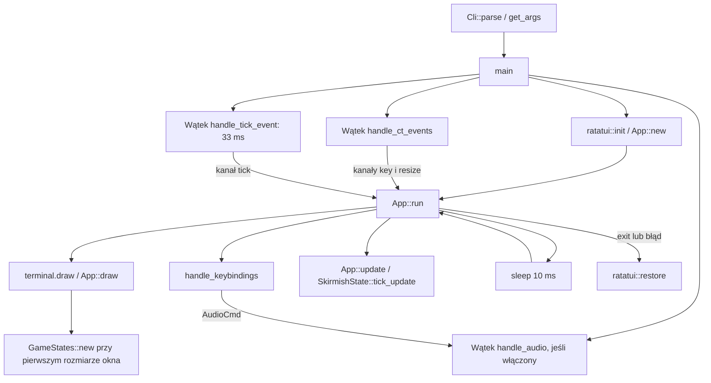
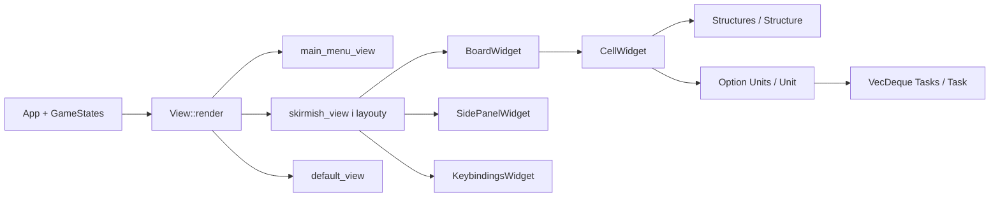

# Mapa kodu i przepływu

Migawka: 2026-10-18. Projekt `war_in_tunnels` 0.1.0 to prototyp terminalowego RTS. Działają menu, plansza, nawigacja, zlecanie i wykonywanie kopania oraz audio. Zegar obsługuje zadania jednostek; ekonomia i walka pozostają poza zakresem obecnej symulacji.

## Moduły i odpowiedzialność

Wszystkie ścieżki poniżej są względem katalogu głównego repozytorium.

| Obszar | Pliki | Odpowiedzialność |
|---|---|---|
| Start | `src/main.rs`, `src/lib.rs` | CLI, kanały, wątki, terminal, eksporty biblioteki |
| Parametry | `src/cli.rs`, `src/logs.rs` | Clap, walidacja zakresów, opcjonalny logger |
| Pętla aplikacji | `src/app/app.rs` | `App`, inicjalizacja stanów przy pierwszym rysowaniu, wejście, resize, update |
| Zbiór stanów | `src/app/state.rs`, `src/app/states/` | `GameStates`, menu, potyczka, ustawienia, perki, umiejętności |
| Routing widoku | `src/app/view.rs`, `src/app/views/` | `View`, implementacja `Widget for &mut App`, layouty i ekrany |
| Wejście | `src/app/keybind.rs`, `src/app/keybindings/` | Routing według widoku, `KEYBINDINGS`, `Action`, `Group`, mapowanie zdarzeń |
| Plansza | `src/app/states/skirmish_states/board.rs` | Tworzenie mapy, kamera, zoom, focus, zaznaczenia, zlecanie i wykonywanie zadań |
| Współrzędne | `focused_cell.rs`, `offset.rs`, `marked_cells.rs`, `zoom_level.rs` w `skirmish_states/` | Granice kursora i przewijania, ścieżka zaznaczenia, rozmiar komórek |
| Obiekty gry | `skirmish_states/structures/`, `units/`, `tasks/` | Traity `Structure`, `Unit`, `Task` i delegujące enumy `Structures`, `Units`, `Tasks` |
| Widgety | `src/app/widgets/` | Plansza, komórka, panel boczny i legenda klawiszy |
| Pomocniczy layout | `src/app/helpers/` | Obszar komórek, tytuły bloków i tekst opcji menu |
| Wątki | `src/app/threads/{events,tick,audio}.rs` | Crossterm, zegar 33 ms, Rodio i komendy audio |
| Środowisko | `Cargo.toml`, `flake.nix`, `default.nix`, `flake.lock` | Zależności, toolchain Fenix, ALSA, pakowanie przez Naersk lub buildRustPackage |
| Formatowanie | `rustfmt.toml` | Rustfmt, styl 2024, wcięcia po 2 spacje, docelowo 100 znaków i zakończenia LF |
| Kontrole CI | `.gitea/workflows/rust.yml` | Gitea Actions: formatowanie, kompilacja, testy debug/release i Clippy przez Nix |
| Zasoby | `soundtracks/default/`, `ui_draft/` | Dwa pliki OGG i tekstowe szkice ekranów |

Ścieżki skrócone `skirmish_states/` oznaczają `src/app/states/skirmish_states/`. Nie ma osobnego silnika gry, bazy danych ani warstwy sieciowej. Zależności Cargo: Ratatui/Crossterm, Clap, Rodio, log/simplelog i once_cell.

`Cargo.toml` deklaruje Rust 1.88 jako minimalną wspieraną wersję, wymusza `unused_must_use = "deny"` i `unsafe_code = "forbid"` we własnym kodzie, dopuszcza `clippy::unused_unit` oraz włącza `overflow-checks` w release. Toolchain deweloperski nadal pochodzi z Fenix przypiętego przez `flake.lock`; wersję 1.88.0 sprawdzono osobno.

## Uruchomienie i pętla

Kanały to standardowe `std::sync::mpsc`. Stan gry mutuje główny wątek. Każdy obrót pętli najpierw rysuje, następnie próbuje odebrać po jednym zdarzeniu z każdego kanału. Aktualizacja potyczki odbywa się niezależnie od wybranego ekranu. `tick_update` wykonuje `board.advance_turn()` i zwiększa `turn_counter`.

`GameStates::new` tworzy wszystkie stany jednocześnie. `SettingsState` przechowuje parametry z CLI; samo istnienie parametrów ekonomii, XP i trybu gry nie oznacza zaimplementowanych mechanik. `View` zawiera MainMenu, Skirmish, PerkDecks i SkillsConfig. Dwa ostatnie używają `default_view` z napisem „Work in progress”; ustawienia nie mają osobnego wariantu `View`.

## Renderowanie i dane

`BoardState.cells: Vec<Vec<CellWidget>>` łączy model i prezentację: komórka zawiera strukturę, opcjonalną jednostkę, pozycję i flagi UI. `BoardWidget` wybiera widoczne komórki przez offsety i layout; `CellWidget` odpowiada za ich tekst i styl. Panel boczny prezentuje dane zaznaczenia. Zoom wpływa na wielkość komórek i liczbę widocznych wierszy/kolumn; resize i przełączanie panelu zmieniają granice offsetów.

Mapa powstaje deterministycznie: kamień, baza gracza w `(map_height / 2, 2)`, baza przeciwnika w `(map_height / 2, map_width - 3)`, sąsiadujące złoża i po jednym górniku w bazie. CLI domyślnie wybiera mapę 42 × 11; dopuszczalne zakresy to szerokość 36–108 i wysokość 11–39. Dostępne struktury to Base, Ore, Stone, Tunnel; jedyna jednostka to Miner. Zadania to Digging i Moving, implementujące wspólny trait Task.

## Klawisze i zlecanie kopania

1. `handle_ct_events` odbiera zdarzenie Crossterm i przekazuje je kanałem do `App`.
2. `handle_keybindings` wybiera obsługę menu, potyczki albo domyślną.
3. `event_to_action` porównuje kod, rodzaj i modyfikatory z `KEYBINDINGS`, następnie obsługuje znak wildcard.
4. Akcje wspólne realizują wyjście, powrót do menu i komendy audio.
5. W potyczce ruch zmienia focus i ewentualnie kamerę; zoom przelicza rozmiary; Tab przełącza panel.
6. Spacja przełącza zaznaczanie. `start_marking_cells` zapamiętuje jednostkę z komórki początkowej; ruch dopisuje współrzędne do kolejki. Backspace cofa ścieżkę, Delete ją anuluje.
7. `end_marking_cells(false)` pomija pierwsze pole i dzieli trasę na kolejne jednorodne odcinki: `MovingTask` dla tuneli/baz i `DiggingTask` dla kamienia. Dodaje je do kolejki w kolejności ścieżki; w panelu zadania mają ikony `→` i `⛏`.

`start_marking_cells` dopuszcza wyłącznie własnego górnika. Jeśli ma już zadania, nowa ścieżka zaczyna się na końcu ostatniego zadania. Jednostka wybrana do rysowania wstrzymuje wykonywanie zadań do zatwierdzenia lub anulowania trasy; powtarzany ruch przy granicy nie dopisuje kolejnych kopii tej samej kratki.

`advance_turn` najpierw zbiera pozycje pracujących jednostek, aby każda była aktualizowana tylko raz. Wyjmuje jednostkę i pierwsze zadanie, sprawdza granice, sąsiedztwo i zajętość celu. Przy kamieniu różnica skumulowanego postępu zadania daje obrażenia: `digging_power` 0.55 oznacza około 5.5 durability na tick przy maksymalnym durability 1000. Zaokrąglenie skumulowanej wartości zachowuje część ułamkową. Pełne kopanie trwa około 182 ticków (6 sekund). `Stone::take_damage` nie pozwala zejść poniżej zera.

Po zniszczeniu kamienia cel staje się tunelem i jednostka wchodzi do niego w tym samym ticku w ramach `Digging`. `MovingTask` obsługuje przejście do istniejącego tunelu lub pustej bazy: wymaga 91 ticków (3003 ms przy `TICK_MS = 33`), nie zmienia durability. Jego licznik `ticks` resetuje się dla każdego kroku; blokada lub rysowanie trasy wstrzymuje naliczanie. Jeśli teren zmieni się od zaplanowania trasy (np. kamień został już wykopany albo ścieżka wraca przez nowy tunel), `advance_turn` zmienia typ bieżącego zadania według aktualnego celu, zachowując pozostałą ścieżkę i kolejkę.

Ruch aktualizuje współrzędne jednostki i usuwa krok ścieżki. Zakończone zadanie znika, następne może wykonać się od kolejnego ticka. Zajęty cel lub ruda blokuje pracę bez niszczenia obiektu. Pusta ścieżka jest usuwana, a cel poza mapą lub niesąsiadujący anuluje bieżące zadanie bez teleportacji. Uszkodzony kamień pokazuje pozostałą wytrzymałość w procentach na planszy; panel boczny pokazuje dokładne durability. Znacznik jednostki jest osobnym stylowanym `Span` z kolorem `Players::get_color()`, niezależnym od koloru tunelu i zaznaczenia komórki.

Postęp bieżącego kroku jest udostępniany przez `MovingTask::get_movement_progress()`: brak wartości przed rozpoczęciem ruchu, procent obliczany z tego samego `MOVEMENT_TICKS`, który wyznacza czas przejścia. `CellWidget` odczytuje go wyłącznie z aktywnego `Tasks::Moving` i pokazuje na środku kratki jednostki w kolorze jej właściciela. W normalnym i powiększonym widoku pozostaje widoczny osobny znacznik jednostki; w pomniejszonym procent zastępuje znak struktury na czas ruchu. Zakończenie kroku resetuje wskaźnik. `DiggingTask` przechowuje wyłącznie postęp kopania, bez licznika podróży.

`Task::get_progress()` oznacza postęp bieżącej kratki, a `get_total_progress()` uwzględnia wykonane kratki i bieżący etap. Oba typy zadań zapamiętują początkową długość trasy w `total_steps`; `from_digging` i `from_moving` zachowują ją przy zmianie typu. `MinerUnit::get_tasks_formatted()` prezentuje każde zadanie w dwóch wierszach: trasa oraz `Step: …% | Total: …%`. Wartość całkowita jest liczona według liczby kratek, nie szacowanego czasu pozostałego do końca.

## Audio i pakowanie

Główny wątek wysyła `AudioCmd`; osobny wątek obsługuje głośność, mute, część i soundtrack. Cache wykorzystuje `Lazy`, `RwLock`, `Arc` i bajty OGG. Calm ładuje `calm.ogg`; Buildup, Assault i Outro korzystają obecnie z `test.ogg`. Błędy urządzenia, odczytu i dekodowania mogą zakończyć wątek przez `expect`.

Rodio zapętla źródło przez `Decoder::new_looped`. Wątek sterujący blokuje się na odbiorniku (`for cmd in rx`), zamiast aktywnie sprawdzać komendy i koniec utworu. Zmiana części lub soundtracku dopisuje zapętlone źródło i pomija bieżące przez `skip_one`. Zamknięcie kanału kończy wątek. Test `audio_repeats_after_end_of_file` sprawdza przekroczenie końca rzeczywistego pliku OGG bez urządzenia audio.

`flake.nix` dostarcza devShell dla `x86_64-linux`, domyślny pakiet z `default.nix` i pakiet `.#develop` budowany przez Naersk. Obie ścieżki pakowania kopiują soundtracki do `$out/bin` i zmieniają nazwę binarki na `war-in-tunnels`. `default.nix` ma stały `cargoHash`; po zmianie zależności wymaga osobnej weryfikacji. Samo `cargo test` nie sprawdza pakowania.

## Punkty wymagające uwagi przed dalszą implementacją

To obserwacje statyczne, nie lista napraw wykonanych w tej sesji:

- **Blokady:** jednostki czekają przed zajętym polem i rudą. Nie ma automatycznego omijania przeszkód ani rozwiązywania sytuacji, w której dwie jednostki wzajemnie blokują przejście.
- **Zaznaczenie:** wybrany górnik czeka podczas rysowania trasy; inne jednostki wykonują zadania normalnie.
- **Audio:** usunięto aktywne odpytywanie; pomiar CPU na docelowym urządzeniu i odsłuch pozostają do wykonania. Test dekodera nie weryfikuje urządzenia audio.
- **Granice UI:** małe terminale, resize i trzy poziomy zoomu wymagają interaktywnego sprawdzenia. Indeksowanie planszy zakłada poprawne współrzędne.
- **Pokrycie:** 45 testów CLI, sterowania, renderowania, planszy, wykonywania zadań i dekodowania audio; szczegóły w [TESTING.md](TESTING.md). Workflow Gitea sprawdza też profil release; nie obejmuje pełnej rozgrywki. Clippy zgłasza 50 ostrzeżeń biblioteki, `unused_unit` jest jawnie dozwolony. Nie uruchamiać automatycznych poprawek poza zakresem zadania.

## Gdzie zacząć konkretną zmianę

| Zadanie | Główne miejsca i powiązania |
|---|---|
| Nowa akcja | `keybindings/keybindings.rs` → handler widoku → lista akcji w `views/` |
| Mechanika kopania | `tasks/digging.rs` → `units/` → `board.rs::advance_turn` → `skirmish.rs::tick_update` |
| Nowy obiekt | Trait i enum w `structures/` lub `units/`, eksporty `mod.rs`, tworzenie mapy, komórka i panel |
| Kamera i zoom | `board.rs`, `focused_cell.rs`, `offset.rs`, `zoom_level.rs`, `helpers/cells_area.rs`, layout i widget planszy |
| Nowy ekran | `View`, `GameStates`, `states/`, `views/`, routing klawiszy i menu |
| Parametr CLI | `cli.rs`, walidacja, `GameStates::new`, faktyczny konsument i README |
| Audio lub dystrybucja | `threads/audio.rs`, `main.rs`, zasoby, `flake.nix`, `default.nix` |
